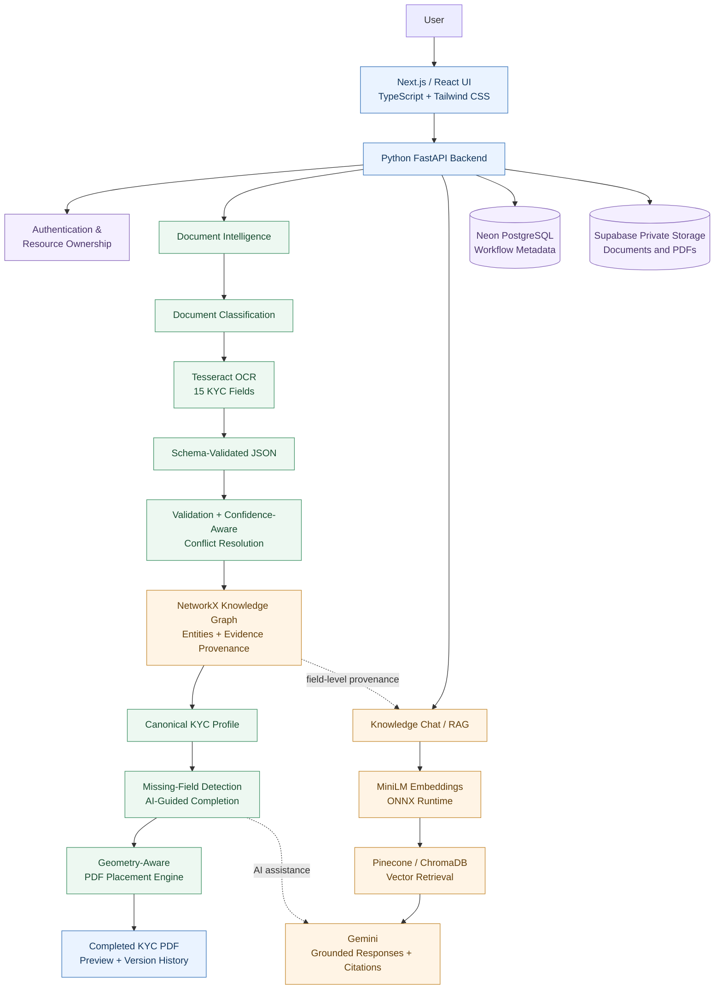
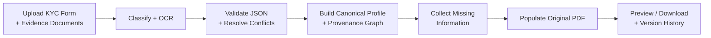
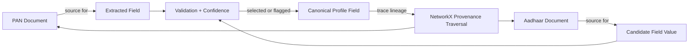
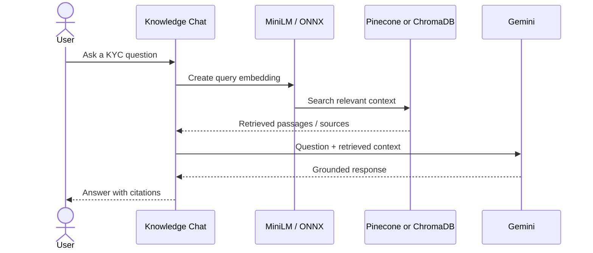
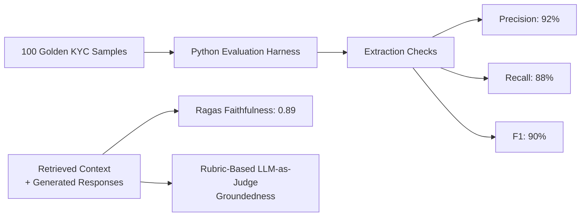
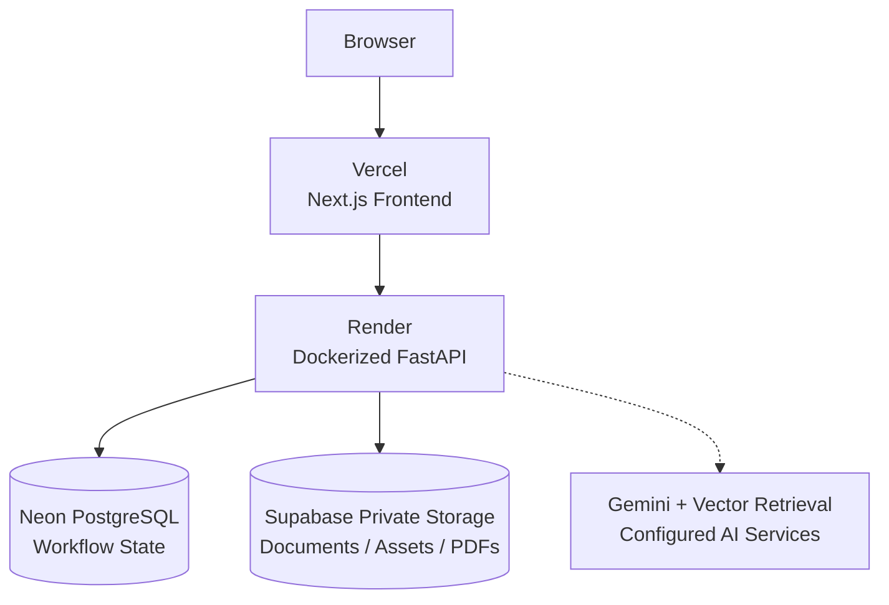

# ⚔️ KnightForge Sahayak

### AI Paperwork Copilot — From KYC Documents to Completed Forms

**OCR · Schema Validation · Gemini · RAG · Knowledge Graph · PDF Automation**

[](https://knight-forge-sahayak.vercel.app/)


**KnightForge Sahayak** is an individual AI-powered KYC paperwork copilot built for **OpenAI Build Week 2026**. It converts fragmented document-based onboarding into a guided, evidence-backed workflow: upload identity documents and a KYC form, extract and reconcile information, complete missing fields, and generate a filled PDF.

The system combines **Python OCR for 15 KYC fields**, schema-validated JSON, confidence-aware conflict resolution, a **NetworkX provenance graph**, and **Gemini + retrieval-augmented generation (RAG)**. Deterministic rules handle validation, authorization, and precise PDF placement.

> **Design principle:** Use AI for interpretation and assistance; use deterministic logic for correctness, document placement, and access control.

## 🔗 Live Application

**[Launch KnightForge Sahayak](https://knight-forge-sahayak.vercel.app/)**

> The public demo uses free-tier infrastructure. The backend may take time to wake after inactivity. Do not upload real sensitive identity documents to a public demo unless you understand its data handling and are comfortable doing so.

## 📊 Project at a Glance

| Area | Implementation / Project-reported result |
| :--- | :--- |
| Structured extraction | **15 KYC fields**, Python OCR, schema-constrained JSON |
| Evaluation set | **100 golden KYC samples** |
| Extraction quality | **92% precision · 88% recall · 90% F1** |
| RAG grounding | **0.89 Ragas faithfulness** |
| Measured latency | **1.8 s → 650 ms** (~64% reduction) |
| Explainability | **NetworkX** graph linking fields, entities, and source evidence |
| AI and retrieval | **Gemini, MiniLM, Pinecone, ChromaDB, RAG** |
| Output | Completed, layout-preserving KYC PDFs with version history |

*Evaluation figures come from the project's reported test setup. They are not independent certifications, production SLAs, or guarantees across all documents.*

---

## 🎯 The Problem

KYC onboarding is repetitive: people re-enter the same information across forms with different labels, layouts, checkboxes, and photo/signature requirements. Information may be spread across PAN, Aadhaar, Driving Licence, bank records, and partially completed forms. OCR errors or conflicting documents make a simple copy-and-paste approach unreliable.

**Sahayak's solution:** build one reusable **Canonical KYC Profile** backed by validated values and traceable evidence, then populate each supported form according to its own layout.

## ✨ Key Features

| Capability | What Sahayak does |
| :--- | :--- |
| **Document classification** | Distinguishes primary KYC forms from supporting identity/account documents. |
| **OCR and extraction** | Extracts 15 targeted KYC fields with Python OCR into structured JSON. |
| **Schema validation** | Checks structured values and form-specific requirements before accepting them. |
| **Conflict resolution** | Uses validity, confidence, and source evidence to detect disagreements instead of silently overwriting values. |
| **Canonical KYC Profile** | Consolidates reusable information from uploaded documents, existing forms, and user answers. |
| **Evidence provenance** | Uses NetworkX relationships and traversal to trace an extracted field back to supporting evidence. |
| **AI-guided completion** | Asks for missing or applicable information rather than repeating known fields. |
| **Knowledge Chat** | Uses MiniLM retrieval, Pinecone/ChromaDB vector stores, and Gemini for grounded KYC assistance with citations. |
| **PDF automation** | Places text, checkboxes, photographs, and signatures into form-specific PDF regions. |
| **Preservation and history** | Preserves existing valid entries and original PDFs; supports generated-file preview and versioning. |
| **Session security** | Enforces authentication, server-side ownership checks, and private document access. |

---

## 🏗️ System Architecture

The diagram shows the major logical components. Pinecone and ChromaDB are retrieval components; the configured workflow determines which vector store is used.



### End-to-End Workflow



1. **Upload:** Provide a supported KYC form and evidence documents.
2. **Interpret:** Classify files and extract 15 target fields using OCR.
3. **Validate:** Apply structured schemas and compare conflicting candidate values.
4. **Consolidate:** Build a canonical profile with confidence and source references.
5. **Complete:** Ask only for missing or unresolved information.
6. **Generate:** Fill the correct fields, checkboxes, photo, and signature regions in the selected form.
7. **Review:** Preview or download the generated PDF while retaining version history.

---

## 🕸️ Knowledge Graph and Field Provenance

OCR gives a proposed value; it does not, by itself, explain **where that value came from**. The NetworkX graph represents relationships among documents, extracted entities/fields, and evidence. Traversal helps explain why a candidate was accepted or flagged.



For example, when two documents contain different candidate values, Sahayak can inspect validation results, confidence, and source relationships, then flag unresolved conflicts for confirmation instead of treating the newest OCR result as correct.

## 🧠 RAG-Powered Knowledge Chat

The knowledge assistant answers KYC-related questions using retrieved context rather than relying solely on the language model.



The AI layer includes **Gemini**, **MiniLM embeddings**, **ONNX Runtime**, **Pinecone / ChromaDB**, **RAG**, and evaluation with **Ragas** and rubric-based **LLM-as-judge** scoring. The source-grounding checks complement deterministic field validation; they do not replace it.

---

## 🗂️ Supported Documents and Forms

### Primary KYC Forms

| Form | Support |
| :--- | :---: |
| CVL / CDSL Individual KYC | ✅ |
| SBI KYC Updation — Annexure A | ✅ |
| HDFC KYC | ✅ |
| ICICI / Central KYC Registry | ✅ |
| Axis Bank / Central KYC Registry | ✅ |

Supported supporting evidence includes **PAN, Aadhaar, Driving Licence, bank/account documents, and partially completed KYC forms**. Actual extraction depends on the document type and scan quality.

### Geometry-Aware PDF Generation

Each form uses its own placement manifest and measured PDF regions for text, checkboxes, choices, photographs, and signatures. The generation logic preserves already-valid entries, excludes office-use/institution-only regions, retains the original uploaded PDF, and maintains generated versions.

---

## 🧪 Evaluation and Results

A **Python evaluation harness** was built around **100 golden KYC samples** for structured-extraction checks. Groundedness of generated answers was additionally assessed with **Ragas faithfulness** and a **rubric-based LLM-as-judge**.

| Metric | Project-reported result | Interpretation |
| :--- | ---: | :--- |
| Extraction precision | **92%** | Fraction of predicted field values counted as correct. |
| Extraction recall | **88%** | Fraction of expected field values recovered correctly. |
| Extraction F1 | **90%** | Harmonic mean of precision and recall. |
| Ragas faithfulness | **0.89** | Whether answer claims are supported by the retrieved context. |
| Measured AI/retrieval latency | **1.8 s → 650 ms** | Before/after observation on the evaluated path; about **64% lower**. |



**Evaluation scope:** These are results reported for the project's own data and benchmark conditions. The latency figure is **not** an end-to-end OCR-to-PDF guarantee, and the evaluation does **not** imply official KYC or regulatory certification.

---

## 🛠️ Technology Stack

| Layer | Technologies |
| :--- | :--- |
| **Frontend** | Next.js, React, TypeScript, Tailwind CSS |
| **Backend** | Python, FastAPI, Pydantic, SQLAlchemy, Alembic, Uvicorn |
| **OCR and PDFs** | Tesseract OCR, PyMuPDF, Pillow, schema-driven extraction, placement manifests |
| **GenAI / Retrieval** | Gemini, RAG, MiniLM, ONNX Runtime, Pinecone, ChromaDB |
| **Graph / Evaluation** | NetworkX, Ragas, Python evaluation harness, rubric-based LLM-as-judge |
| **Database** | Neon PostgreSQL (production); SQLite where configured locally |
| **Object Storage** | Supabase private storage |
| **Authentication** | JWT, refresh tokens, Google OAuth, resource ownership checks |
| **Deployment / Tools** | Docker, Render, Vercel, Git, GitHub, OpenAI Codex |

### Deployment Architecture



---

## 🚀 Run Locally

### Prerequisites

- **Python 3.12+**
- **Node.js 20+** and npm
- **Git**
- **Tesseract OCR** installed and accessible to the backend
- Required database, storage, and AI configuration for the features you use

### 1. Clone the repository

```bash
git clone <YOUR_REPOSITORY_URL>
cd knightforge-sahayak
```

Replace `<YOUR_REPOSITORY_URL>` with your repository's Git URL.

### 2. Start the backend

```bash
cd backend
python -m venv .venv
```

Activate the environment:

**Windows PowerShell**

```powershell
.\.venv\Scripts\Activate.ps1
```

**macOS / Linux**

```bash
source .venv/bin/activate
```

Install dependencies, configure the environment, and run the API:

```bash
pip install -r requirements.txt
# Configure backend/.env using backend/.env.example as a reference.
alembic upgrade head
uvicorn app.main:app --reload --port 8000
```

Run migrations if your selected database setup requires them. Do **not** commit API keys or credentials.

- **Backend:** http://localhost:8000
- **Health endpoint:** http://localhost:8000/health
- **API documentation:** http://localhost:8000/docs

### 3. Start the frontend

Open a new terminal at the repository root:

```bash
cd frontend
npm install
```

In `frontend/.env.local`, configure:

```env
NEXT_PUBLIC_API_BASE_URL=http://localhost:8000
```

Start the application:

```bash
npm run dev
```

Open **http://localhost:3000**. Keep both servers running.

> Other backend environment variables are deployment-specific. Refer to the repository's `.env.example` and actual service configuration rather than copying invented API-key names.

---

## ✅ Testing and Verification

### Backend regression suites

From `backend/`, run the scripts available in the project:

```bash
python e2e_phase15.py
python e2e_phase16.py
python e2e_phase17.py
python e2e_phase18.py
```

### Frontend checks

From `frontend/`:

```bash
npx tsc --noEmit
npm run lint
npm run build
```

The **100-sample evaluation harness** and groundedness checks are separate from these general regression and build checks. Its exact CLI is not specified here; use the actual evaluation entry point in the repository.

---

## 🔐 Security and Privacy

Because KYC documents contain sensitive personal information, access control is enforced on the **backend**, not delegated to the LLM.

- JWT/refresh-token authentication and Google OAuth
- Server-side ownership checks and cross-user isolation
- Private storage for documents, photos, signatures, and generated PDFs
- Upload validation, restricted CORS, and rate limiting on sensitive endpoints
- Separation of AI-generated suggestions from authorization and field-validation decisions

> **AI is not the security boundary.** All generated fields and completed documents should be reviewed by the user before submission.

## ⚙️ Engineering Challenges and Design Choices

| Challenge | Approach |
| :--- | :--- |
| **Different KYC layouts** | Form-specific geometry manifests and schema-driven requirements. |
| **Blank-form labels mistaken for values** | Region-aware OCR and deterministic validation. |
| **Conflicting identity evidence** | Confidence-aware merging plus NetworkX source provenance. |
| **Incomplete or prefilled forms** | Non-destructive merging and guided missing-field completion. |
| **Unsupported LLM claims** | Retrieval grounding, citations, Ragas, and LLM-as-judge checks. |
| **PDF checkboxes / photos / signatures** | Measured placement regions and dedicated image-asset handling. |
| **Persisting data across deployments** | PostgreSQL workflow metadata and private object storage. |
| **Performance and reliability** | Retrieval-path optimization, smoke tests, and regression-driven fixes. |

## 🔮 Future Improvements

- Asynchronous OCR workers with real-time progress updates
- More supported institutional forms and multilingual document extraction
- Human-in-the-loop verification for ambiguous identity fields
- Persistent document-processing cache and scalable job queues
- More comprehensive provenance visualization and error analysis
- Reproducible, privacy-safe benchmark fixtures and evaluation commands
- Stronger observability, monitoring, and production-scale OCR adapters

---

## 🏆 Project Background

Built as an **individual project for OpenAI Build Week 2026**. **OpenAI Codex** was used as an engineering collaborator for implementation, debugging, testing, architectural iteration, PDF geometry work, and deployment hardening.

## ⚠️ Disclaimer

KnightForge Sahayak is an **educational and hackathon demonstration**. It is not an identity-verification authority or a substitute for official financial, legal, regulatory, or compliance advice. Generated documents must be reviewed before submission. Reported evaluation metrics are limited to the tested setup and should not be interpreted as formal certification.

## 👨‍💻 Author

**Prasad Nathe**

## 📜 License

This project is presented for demonstration, education, and hackathon purposes. No open-source license is specified here; check the repository for a dedicated `LICENSE` file before assuming reuse permissions.
